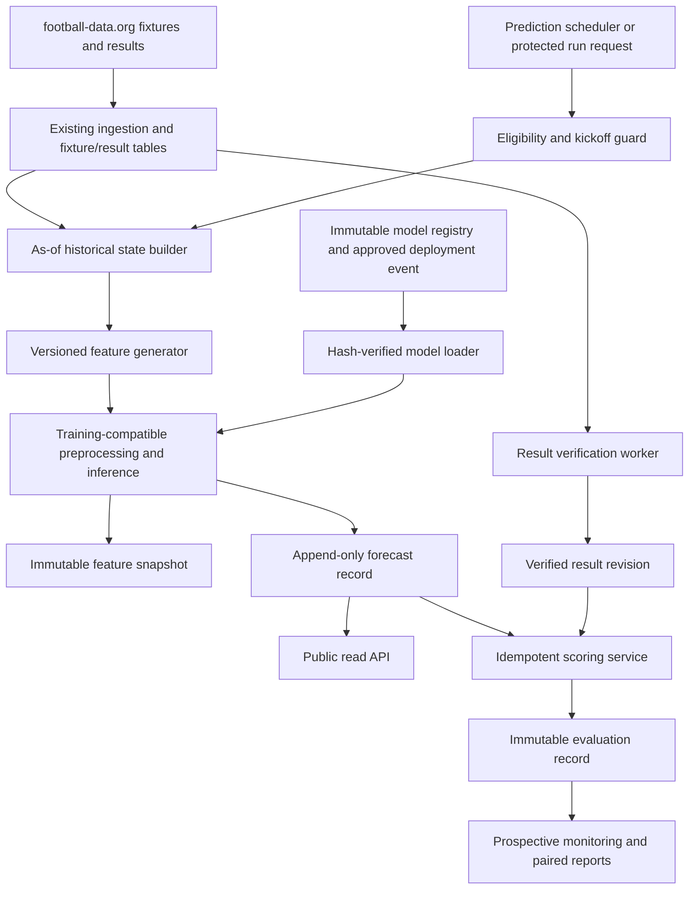
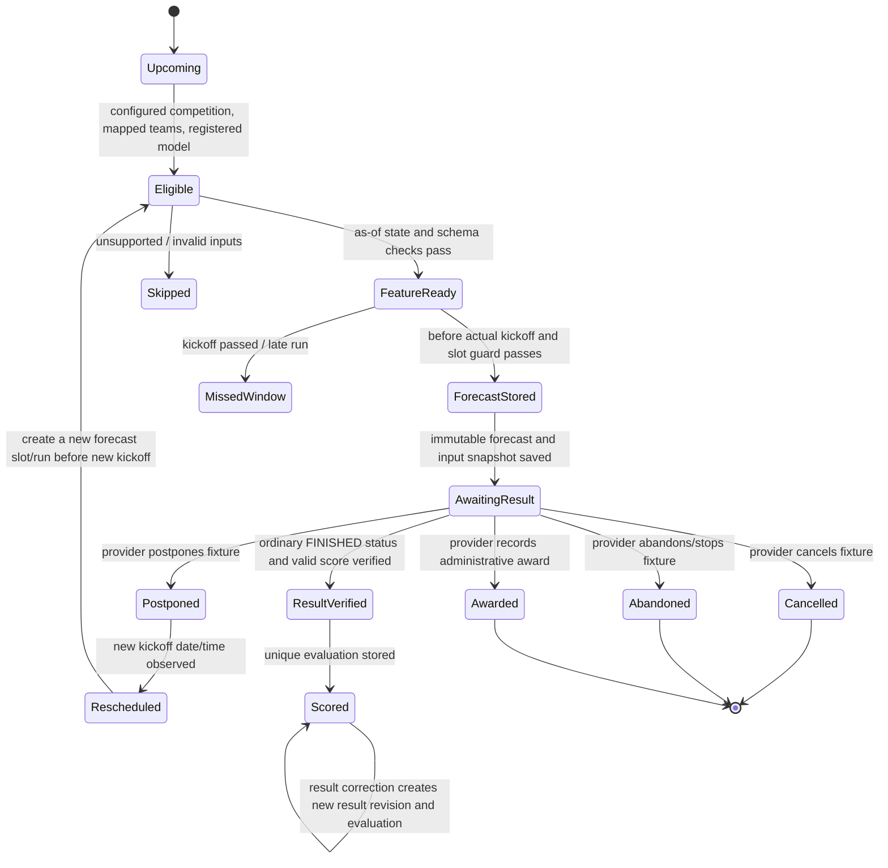

# Phase 3G.1 — Prediction Infrastructure Architecture

**Status:** Design only. No code, migration, database, model, prediction, frontend or dependency changes are included.

## 1. Proposed architecture

Keep the current separation of responsibilities and add backend inference services around the existing offline model artifacts:



Responsibilities:

- **FastAPI**: typed public reads and authenticated internal run/result/scoring operations. It does not receive artifact paths or arbitrary model objects from clients.
- **Worker/job process**: selects upcoming fixtures, captures forecasts at the registered lead time, verifies final provider results, and scores pending records. Existing CLI jobs are manual data jobs, not a prediction scheduler.
- **Model registry/loader**: resolves a registered immutable model version, verifies its artifact/configuration hashes and feature schema, loads the supported estimator/preprocessor, and refuses unregistered or incompatible artifacts.
- **Feature service**: constructs inference features from an as-of snapshot using the approved v2 feature definitions and only verified results available before the permitted cutoff.
- **PostgreSQL**: stores registry metadata/events, forecast snapshots, immutable predictions, verified result revisions, and scores. Existing raw fixture/result tables remain the provider data layer.
- **Evaluation service**: computes metrics from persisted forecasts and linked result revisions. It never regenerates a historical prediction.

## 2. Model registry and versioning

Use an immutable registry entry keyed by `(model_name, semantic_version)` with:

- artifact URI relative to a configured read-only model root (or approved object-storage key), artifact SHA-256, manifest/configuration SHA-256, model family, feature schema version and ordered feature names;
- preprocessing artifact identity, target/output contract, goal-rate clamp and score-grid settings, runtime/library compatibility metadata, training dataset hash and training cutoff;
- created timestamp and creator/build revision.

Never accept a file path, serialized estimator or artifact URI from a public API request. The loader resolves only a registered entry, canonicalizes the path under the configured model root, checks the hash before deserializing, and rejects unsupported schema/runtime versions. Because `joblib` artifacts are executable pickle payloads, only trusted, integrity-verified artifacts may be loaded. Model directories should be read-only to the running API/worker account.

Keep candidate approval and activation as append-only `model_version_events`/`model_deployment_events`; do not mutate a model artifact or overwrite a version directory. Events distinguish `RESEARCH_CANDIDATE`, `APPROVED`, `ACTIVE`, `DEPRECATED`, `ROLLED_BACK` and `REJECTED`, with actor, timestamp, reason, and referenced evaluation/protocol version. The active model is derived from the latest valid deployment event for an environment and model slot. Rollback appends a deployment event reactivating the prior immutable version; it never rewrites history. Candidate models may run only through an explicitly authorized research/prospective cohort and cannot be returned as active production predictions.

Each prediction stores the exact registry ID, artifact hash, config hash and feature schema version it used, even if that model is later deprecated or rolled back.

## 3. Inference features and historical state

### Point-in-time rules

Reuse the approved v2 feature definitions in `ml/features/feature_engineering_v2.py`, including the six strength inputs, six form/recent-goal inputs, Elo difference and two exposure counts. Reuse the final C preprocessing artifact exactly; do not refit imputation/scaling during inference. The A adapter must likewise use A's original six inputs and formula. Each model version declares its own exact ordered schema and preprocessor contract.

Build state from source records with two cutoffs:

1. A result must have a verified final score/status and an `available/verified_at` timestamp no later than the prediction timestamp.
2. Its kickoff UTC date must be strictly earlier than the target fixture's kickoff UTC date. The existing same-UTC-date batch rule remains in force, even if an earlier same-day fixture has finished before a later kickoff.

All fixture features for one UTC date are generated before any results from that UTC date update competition baselines, team histories, form or Elo. State updates apply in chronological UTC-date batches. For reproducibility and protection against later provider corrections, persist the exact feature vector, feature schema/order, snapshot hash, state/result watermark and source record/revision identifiers with every forecast; do not rebuild old features from the present database.

For C, the inference state builder must match training behavior: six competition pools; expanding home/away competition scoring baselines with the 20-observation readiness threshold; 365-day half-life weighted attack/defence strengths and five-match pseudo-prior; last-five same-competition appearances with partial averages and null if no prior appearance; separate competition Elo pools with the approved 1500 initialization, 400 scale, K=10, +60 home advantage and 0.75 offseason regression; eligible `FINISHED` results only. Exclude `AWARDED`, abandoned, cancelled, postponed and unfinished results from all learning state, following the approved v2 policy. A future policy change must create a feature schema/version change and a separately evaluated model; do not silently reinterpret old forecasts.

### Input and output validation

- Validate fixture/team/competition identifiers, unique home/away teams, timezone-aware kickoff and model-schema compatibility before inference.
- Reject non-finite values, unknown features, invalid ranges, impossible probabilities, and unexpected nulls. Preserve legitimately undefined values as null for the registered preprocessor to handle; record missingness and do not invent statistics.
- Apply the frozen preprocessor only after the raw feature vector validates. Persist both the raw ordered feature values and the exact transformed model input (or its deterministic serialized form and hash) so the prediction can be audited.
- Validate every output is finite; all probabilities lie in `[0,1]`; 1X2 probabilities sum to 1 within a defined tolerance; expected goals are nonnegative and respect the registered rate clamp.
- If state cannot be reconstructed to the registered watermark, schema/hash checks fail, or required features are invalid, emit a failed run/event and no forecast. Do not fall back silently to another model version.

## 4. Database schema and migration proposal

Use SQLAlchemy ORM entities under the existing `backend/app/db/models.py` conventions and Alembic migrations under `backend/migrations/versions/`. Preserve current `CompetitionRecord`, `SeasonRecord`, `TeamRecord`, `FixtureRecord` and `MatchResultRecord`; new tables reference their stable local IDs and provider IDs remain useful for audit.

| Entity | Important fields and constraints | Relationship / purpose |
|---|---|---|
| `model_versions` | PK; model name/version unique; immutable artifact/config hashes; artifact URI/key; model family; feature schema/version and ordered columns JSON; preprocessing hash; training cutoff/data hash; created-at; runtime metadata JSON. | Registered trusted artifact. No artifact bytes or client-selected path. Immutable after registration. |
| `model_version_events` | PK; model-version FK; event type; occurred-at; actor; reason; evaluation/protocol reference; metadata. | Append-only approval/rejection/deprecation history. Current state is a projection, not a destructive update. |
| `model_deployment_events` | PK; environment/model slot; model-version FK; event (`ACTIVATE`/`ROLLBACK`/`DEACTIVATE`); timestamp; actor; reason; prior event FK. | Append-only active-version/rollback history. A deployment points only to a registered approved version. |
| `prediction_runs` | UUID PK; idempotency key unique; cohort/protocol version; requested model-version IDs; fixture selection/query; started/finished timestamps; status/counts; code/config hash; safe error summary. | One requested batch; links generated prediction rows/events. |
| `prediction_feature_snapshots` | UUID PK; fixture FK; model-version FK; schema version; ordered raw feature JSON; transformed model-input JSON; SHA-256 for both; source watermark/verified-at cutoff; source record/revision manifest; generated-at. | Immutable exact per-prediction input snapshot. Avoid storing only a hash with no recoverable values. |
| `predictions` | UUID PK; fixture FK; model-version FK; run FK; feature-snapshot FK unique; forecast slot/cohort; created-at UTC; scheduled kickoff, teams, competition and season copied as-of forecast; home/draw/away probabilities; expected home/away goals; predicted score; status projection; optional `supersedes_prediction_id`; payload hash. | Immutable forecast facts. Index fixture/model/time. Idempotency unique key such as `(fixture_id, model_version_id, forecast_slot, cohort_id)`, allowing multiple registered slots/cohorts while blocking retry duplicates. |
| `prediction_events` | PK; prediction FK; event type; timestamp; actor/source; reason; JSON metadata. | Append-only status trail: captured, scored, invalidated, missed-window, rescheduled, excluded, etc. The immutable prediction values never change. |
| `verified_result_revisions` | UUID/PK; fixture FK; monotonic revision number unique per fixture; provider source/status; full-time scores/winner if valid; provider-updated-at; fetched-at; verified-at; response hash; verification rule/version; supersedes-result FK. | Append-only verified result history. Do not rely on mutable current `MatchResultRecord` as the only audit record. Only a verified ordinary final result is scoreable. |
| `prediction_evaluations` | PK; prediction FK; result-revision FK; scoring-version; scored-at; metric outputs JSON; target snapshot/hash. Unique `(prediction_id, result_revision_id, scoring_version)`. | Idempotent score record tied to the exact forecast and exact result revision. A corrected result adds a new evaluation, retaining the former one. |

Use JSONB for versioned feature and metric payloads only where flexible schema is valuable; retain typed columns for IDs, timestamps, statuses and common probability/goal outputs. Add foreign keys, check constraints for probability range and score validity, UTC-aware timestamps, indexes for fixture/version/kickoff/status and result scoring queues, and migration-level protection for immutable records (permissions/trigger or equivalent service-enforced append-only strategy). Keep raw ingestion updates separate from verified result revisions so ordinary synchronization cannot erase audit history.

### Transaction boundaries

1. **Run creation:** transaction inserts a run with an idempotency key and immutable request/config snapshot; unique conflict returns the existing run.
2. **Per-fixture inference:** read fixture and source state in a consistent transaction/snapshot; compute/validate outside a long-held write transaction if necessary; recheck kickoff/version/idempotency immediately before insert; atomically insert feature snapshot, prediction, and initial prediction event. A unique conflict is a retry/no-op, not an overwrite.
3. **Result verification:** transaction inserts a new verified result revision only after the provider status, fixture association and score checks pass; do not update earlier revisions.
4. **Scoring:** transaction inserts evaluation with unique idempotency key and a `SCORED` event/projection. Repeating the operation returns the existing score. A result correction is scored as a distinct result revision.

Use row-level locks or serializable/optimistic rechecks only where concurrent workers could race for the same fixture slot. Never hold a database transaction open during provider network calls.

## 5. API contracts

Prefix routes with `/api/v1`. Public endpoints are read-only and return Pydantic response models. Run creation, result verification, scoring and model lifecycle events require a trusted worker/admin identity; do not expose these writes anonymously. An idempotency key is mandatory for batch writes.

### Start a prediction run

`POST /api/v1/prediction-runs`

Request:

```json
{
  "cohort_id": "prospective-2027q1-v1-v2",
  "model_version_ids": ["registered-A-id", "registered-C-id"],
  "fixture_ids": [12345, 12346],
  "forecast_slot": "T_MINUS_60_MIN",
  "protocol_version": "phase-3f-v1"
}
```

`fixture_ids` may be omitted only when an explicit competition/kickoff UTC window is provided. The server resolves approved/registered versions and eligibility; clients cannot supply artifacts, features, probabilities or results. Return `202 Accepted` with `run_id`, accepted/rejected fixture counts and per-fixture non-sensitive reason codes. Do not return a success forecast for an ineligible or already-kicked-off fixture.

### Read predictions

- `GET /api/v1/fixtures/{fixture_id}/predictions?model_version_id=&cohort_id=&include_history=true` returns forecast rows ordered by `created_at`, with version, timestamp, kickoff-at-forecast, outputs, status and feature-snapshot hash. Feature values are restricted to authorized audit roles if they are not intended for public display.
- `GET /api/v1/model-versions/{model_version_id}/predictions?cohort_id=&from_utc=&to_utc=&status=&cursor=` returns paginated forecasts and coverage metadata. Never return secret artifact paths or internal credentials.
- Optional `GET /api/v1/predictions/{prediction_id}` returns the exact forecast plus an authorized feature snapshot and event/scoring history.

### Record a verified result

`POST /api/v1/fixtures/{fixture_id}/verified-results`

Trusted ingestion/verification worker only. Request includes provider source and fixture ID, provider status, full-time score if and only if valid, provider `lastUpdated`, retrieval timestamp, response payload hash, verification-rule version and evidence. Server checks provider ID mapping and status. `FINISHED` results with valid scores can be scoreable. `AWARDED` is stored as an exceptional status/result revision according to explicit policy but is never treated as an ordinary 90-minute result or used to score regular-match goal/1X2 metrics unless a future protocol explicitly says otherwise. Abandoned/cancelled fixtures have no fabricated score. Return `201` for a new revision or `200` with the existing revision for an idempotent duplicate.

### Score forecasts

`POST /api/v1/prediction-evaluations/score`

Trusted worker/admin only. Request selects a verified result revision or a bounded set of unscored eligible fixture IDs and a scoring version. The server selects predictions created before the actual kickoff, applies status/eligibility policy, inserts idempotent evaluation rows, and returns counts scored/skipped/already scored/errors. The endpoint cannot accept client-provided labels or metric values.

### Read evaluation summaries

- `GET /api/v1/evaluation-summaries?cohort_id=&model_version_id=&from_utc=&to_utc=` returns sample funnel, paired fixture count, date range, exclusions, model hashes, all registered metrics, calibration bins, uncertainty interval metadata, and per-competition/season breakdowns.
- `GET /api/v1/prediction-runs/{run_id}` returns run state, counts and safe diagnostics.

Return stable error codes for unknown versions, unsupported schema, invalid fixture state, kickoff passed, missing/invalid features, invalid result, duplicate/idempotent request and scoring not yet eligible. Never return stack traces or secrets.

## 6. Lifecycle and exceptional fixture handling



- **Postponed/rescheduled:** keep the old prediction and kickoff-at-prediction snapshot. If the original forecast no longer meets the registered actual-kickoff lead-time/eligibility policy, append an exclusion event; a forecast for the new date is a new slot/run, not an overwrite.
- **Cancelled:** preserve any forecast, append cancellation event, do not score.
- **Abandoned:** preserve forecast; do not score as an ordinary finished match. Store provider status and any partial score only as source evidence, not as a regular full-time target.
- **Awarded:** preserve forecast and provider record; exclude from normal 1X2/goals scoring and all historical state updates unless an explicitly reviewed future protocol defines another target. Never reinterpret an award as ordinary play.
- **FINISHED:** score only after result verification, fixture-ID matching, nonnegative integer full-time scores, and required provider/status validation. Result corrections append revisions and new score records; prior scores remain traceable.

## 7. Operational, security and integrity safeguards

- **Duplicate generation:** mandatory idempotency key per run plus database uniqueness on fixture/version/forecast slot/cohort. For retry, return the original row and never update its outputs or timestamp.
- **Kickoff gate:** compare timezone-aware UTC `now` to the persisted actual kickoff snapshot at generation and immediately before commit. Enforce the registered forecast lead-time. Record clock and schedule source; if schedule changes race with generation, abort or append a rescheduled-state event and reevaluate.
- **Model integrity:** only registered versions; verify model/config/preprocessor hashes before load; path containment/read-only storage; no user-provided serialization; no silent fallback. Cache loaded instances by immutable version/hash and invalidate cache only by deployment event.
- **Feature integrity:** exact ordered schema, source watermark, null policy, finite/range checks, same-UTC-date batching, deterministic feature hash. Fail closed on unexpected missingness or unavailable history; permitted null values remain null for frozen preprocessing.
- **Prediction immutability:** core output columns and feature snapshot are append-only. Status changes are events; corrections create a linked new prediction revision rather than update prior predictions. Unique constraints enforce idempotency.
- **Scoring:** server derives targets from verified result revisions. Unique score key prevents duplicates. Never score unfinished, postponed, cancelled, abandoned or awarded outcomes under the ordinary-match policy.
- **Logging:** structured logs include run ID, fixture/provider ID, model version/hash prefix, feature schema/hash, result revision, timestamps, status and reason. Exclude tokens, database URLs, serialized full artifacts and unnecessary personal data. Retain auditable failure events.
- **Transactions:** no network waits inside DB transactions; per-fixture forecast insert is atomic; result revisions and scoring events are transactional. Worker retries are bounded and safe under unique constraints.
- **Rollback:** rollback changes only the active deployment event. Existing forecasts retain the model version/hash that produced them. Predictions from different versions never merge in one model metric bucket.
- **Access control:** public routes are read-only; internal routes require service/admin authentication, rate limits, request validation and audit actor identity. If authentication is not yet implemented, internal write endpoints must remain disabled from public networks.

## 8. Implementation sequence

1. **Contracts and registry:** define Pydantic contracts, immutable artifact manifest, model lifecycle events, hash/path validation and loader tests. Register A/C as candidates; production approval is a separate explicit action.
2. **Point-in-time feature state:** extract/test reusable v2 state updates; add as-of result availability, same-date batching, prediction-time fixture snapshots, schema checks and deterministic raw/transformed snapshot serialization. Compare training/inference feature parity on historical dates without generating prospective predictions.
3. **Migration and persistence:** add registry/event, run, snapshot, prediction/event, verified-result-revision and evaluation tables, constraints, indexes and migration rollback tests. No schema auto-creation.
4. **Offline inference service:** load only registered artifacts, infer a caller-selected fixture in a non-production dry run with no writes, validate outputs, and test failure cases. Do not expose it publicly yet.
5. **Protected API and worker:** implement authenticated run/read/result/scoring endpoints; schedule pre-kickoff execution; add retry/idempotency, kickoff guards and metrics. Start in shadow/research mode only.
6. **Prospective data-quality soak:** capture timestamps/snapshots for a non-promotional trial, verify run coverage and result matching without reviewing comparative performance. Fix operational defects before registering a promotion cohort.
7. **Register and execute Phase 3F cohort:** freeze hashes, protocol, sample threshold, duration and criteria before the first scored comparison. Generate paired A/C forecasts, score verified results, and publish the predeclared report. Promotion still requires separate review and release authorization.

## 9. Test strategy

- **Registry/loader:** registered/unregistered version, valid/changed hashes, path traversal rejection, unsupported schema, trusted artifact loading, missing/corrupt artifact, rollback activation while old forecasts remain linked to old hash.
- **Feature parity/leakage:** training/inference exact ordered feature parity; own-result/future-result exclusion; same-UTC-date batch; verified-at watermark; competition boundaries, new teams, offseason Elo regression, missing data, later provider correction does not change stored forecast snapshot.
- **Persistence:** FK constraints, one-to-many fixture predictions, one canonical retry produces one row, different slots/cohorts create separate rows, immutable prediction/snapshot update rejected, atomic event writes, migration upgrade/downgrade.
- **Kickoff/fixture lifecycle:** timezone conversion, exact boundary around kickoff and T−60 slot, changed/rescheduled kickoff, postponement, cancellation, abandonment, awarded and valid finished status.
- **Scoring:** targets derived only from verified result; idempotent repeat; no score for invalid statuses; correction creates a new result revision and evaluation while retaining old entries; metrics computed from stored forecast probabilities/goal rates and stored result revision.
- **API/security:** schema validation, auth on internal writes, read pagination, no secret/artifact path leakage, client cannot submit targets/features/probabilities, safe error responses, rate limits and audit actor capture.
- **Operations/monitoring:** retries, duplicate workers, missing/late prediction funnel, corrupt model fail-closed behavior, per-model version isolation, paired cohort and confidence-interval reproducibility.

## 10. Risks and unresolved decisions

1. **Forecast timing:** Phase 3F proposes T−60 minutes. Confirm whether to publish one canonical forecast or additional lead-time slots; slots must be pre-registered and compared separately.
2. **C online state:** the approved C pipeline is described for historical rows. A dedicated online/as-of state API and a parity oracle must be established before use; do not assume the offline CSV builder can safely serve forecasts.
3. **Historical v1 inference:** A's original feature schema and shrinkage inputs must be reproduced from current records using only past data. Confirm whether the old six-feature history can be reconstructed prospectively without new fields or whether an explicit adapter is required.
4. **Feature snapshot size/retention:** JSONB raw plus transformed vectors is auditable but grows with forecast count. Define retention, compression and access policy without deleting audit-critical snapshots.
5. **Provider result finality:** determine whether `FINISHED` alone is sufficient or whether a stable repeated response/settlement delay is required; define correction window and verification actor.
6. **Kickoff changes:** the provider's `utcDate` can change. Define the canonical forecast window and whether a forecast moved outside that window is excluded or remains an operationally late prediction.
7. **Security:** the backend currently has no identified auth layer. Select service-to-service/admin authentication and secrets management before enabling write routes.
8. **Registry/deployment ownership:** decide who can register, approve, activate and roll back models and how dual-control approval is recorded.
9. **Database and artifact backup:** define backup/restore guarantees for database audit rows and immutable model artifacts; restore must preserve matching hashes.
10. **Metric contract:** freeze multiclass Brier normalization, classwise calibration binning, bootstrap block definition, and how reschedules/abandoned matches affect coverage before prospective cohort registration.

## Files inspected

- `AGENTS.md`
- `ml/evaluation/phase_3f/prospective_validation_plan.md`
- `ml/evaluation/phase_3f/implementation_gap_report.md`
- `backend/README.md`, `backend/app/main.py`, `backend/app/models.py`, `backend/app/core/config.py`, `backend/app/db/base.py`, `backend/app/db/models.py`, `backend/app/db/session.py`
- `backend/app/services/football_data.py`, `backend/app/services/ingestion.py`, `backend/app/jobs/ingest.py`, `backend/app/jobs/build_training_dataset.py`, `backend/app/jobs/build_training_dataset_v2.py`
- `backend/migrations/env.py`, `backend/migrations/versions/20261122_0001_initial_football_data.py`
- `ml/features/feature_engineering_v2.py`, `ml/train_poisson_comparison.py`, `ml/baselines/poisson.py`
- `ml/models/poisson_baseline/v1/model.json`, `ml/models/poisson_baseline/expanded_history/v1/training_config.json`, `ml/models/poisson_baseline/v2/training_config.json`, `ml/models/poisson_baseline/v2/model_metadata.json`
- `ml/evaluation/poisson_baseline/v1/evaluation.json`, `ml/evaluation/poisson_baseline/expanded_history/v1/comparison_report.md`, `ml/evaluation/poisson_baseline/v2/comparison_report.md`, and the Phase 3E/3E.1 reports referenced by the Phase 3F plan.
- Searched `backend/app` for `APIRouter`, router inclusion, prediction endpoints and prediction persistence; no prediction router/implementation was found.

---

## Phase 3G.1.1 — Implementation-critical clarifications

This section supersedes earlier general wording where this section gives a more specific rule. Items marked **Proposed** remain design decisions for review; they do not assert that the current backend already records them.

### A. Result timestamps: match time versus knowledge time

**Confirmed existing behavior:** `FixtureRecord.retrieved_at` and `MatchResultRecord.retrieved_at` are overwritten on ingestion updates. They represent the most recent local upsert/retrieval time, not first observation, actual match completion, or verification. `Match` exposes scheduled `utcDate`, provider `lastUpdated`, status and scores; its Pydantic schema has no actual-finish timestamp. The ingestion upsert currently does not preserve provider `lastUpdated` in the fixture/result metadata. There is no persisted observation history from which historical first-seen times can be recovered.

**Proposed fields and meanings:**

- `fetched_at`: server UTC time when a successful provider response containing this fixture/result payload was received. Record each relevant observation in an append-only `provider_result_observations` table, including provider fixture ID, status, score fields as returned, provider `lastUpdated` if present, response hash, retrieval attempt/run ID, and `fetched_at`.
- `first_seen_at`: earliest `fetched_at` recorded by this system at which an observation contains an ordinary final status and valid full-time scores. It means **first locally observed**, never “when the provider first published it” or “when the match ended.” Set only from tracked observations; do not backdate it.
- `verified_at`: UTC time after a named validation rule has confirmed fixture-ID mapping, final eligible status, and valid score fields. An append-only `verified_result_revisions` row points to the source observation and stores this timestamp, rule version, reviewer/worker identity, payload hash and revision.
- `match_completed_at`: nullable actual completion time, stored only when an authoritative source explicitly supplies it with provenance. Current football-data.org `utcDate` is the scheduled kickoff and `lastUpdated` is a provider update timestamp; neither is an actual completion time. Do not infer completion from `FINISHED`, ingestion time, or `lastUpdated`.

For results first encountered during a historical import after this tracking is introduced, `first_seen_at` is the import-time observation. Older `retrieved_at` values and historic scores do not establish when the system first knew a result; do not manufacture historical availability timestamps. If no pre-forecast observation was retained, that old result cannot be proven available at a past prediction time and must not be used to reconstruct a purported prospective forecast.

**Prospective availability rule:** a result may update a forecast's state only when its verified revision has `verified_at <= prediction_created_at_utc`, its qualifying observation has `fetched_at <= prediction_created_at_utc`, the result is ordinary eligible `FINISHED`, and its kickoff UTC date is earlier than the target fixture UTC date. The source watermark and exact result-revision IDs are saved with the feature snapshot. This uses system knowledge time, not estimated real-world completion time. A post-launch observation ledger makes the rule auditable going forward; it cannot repair missing historic availability history.

### B. Confirmed A and C inference artifacts/contracts

These files were inspected and SHA-256 checked. C artifacts were loaded for type/parameter inspection and the saved preprocessor transformed a schema-shaped in-memory row to confirm its 13-input/23-output shape; no estimator `.predict()` call, training, or forecast was run.

| Candidate artifact | Exact path | Format | SHA-256 |
|---|---|---|---|
| A parameters | `ml/models/poisson_baseline/v1/model.json` | JSON | `77b138a6014601b19ee32021da3ce80039cafe82270d8d890b524636d3facd1a` |
| C home-goals estimator | `ml/models/poisson_baseline/v2/home_goals_model.joblib` | joblib `sklearn.linear_model.PoissonRegressor` | `435dc6a174dfefbeaf6f31c54c5648beff6fe2598b62acd28a0dd0b9721892d7` |
| C away-goals estimator | `ml/models/poisson_baseline/v2/away_goals_model.joblib` | joblib `sklearn.linear_model.PoissonRegressor` | `aada530c957fac5f38372f78bcf59d353d8664e5b122d3a665448032a878c415` |
| C fitted preprocessor | `ml/models/poisson_baseline/v2/preprocessor.joblib` | joblib `ml.training.fold_preprocessing.FoldPreprocessor` | `eedf6fd40fe5a7c8dc19978979072a71bf567ff9da7c0609a2c7802b0f69ea99` |
| C human-readable fitted metadata | `ml/models/poisson_baseline/v2/model_metadata.json` | JSON | `daf56c22f6f6cb1cf6055ced1c27c7402c3f987205717746456f71a05e8c7a1f` |
| C training configuration | `ml/models/poisson_baseline/v2/training_config.json` | JSON | `b2e4087105ad8b077dcf5bcfe74ecd476c3570f6d24afea973c342f3c3dfcb08` |
| C final preprocessing audit state | `ml/evaluation/poisson_baseline/v2/final_preprocessing.json` | JSON | `51bb07b1f887d121dec13feaca4a8a30217ba7e7feb1cd043df8b23444244db2` |
| C run/config and artifact checksum manifest | `ml/evaluation/poisson_baseline/v2/run_manifest.json` | JSON | `1fce94e4e8bcfac5eac21e38722c5d43deabc4d91391ccc7035d20866ee05157` |

The C run manifest lists hashes for both estimator joblibs and the preprocessor; it also has `model.json` for B. The C JSON metadata/configuration files above have separately computed hashes. Confirmed C inference contract: ordered 13 numeric features from `model_metadata.json.features_used`; `FoldPreprocessor` applies the saved median imputation with missing indicators and standard scaling; transformed input has 23 columns; then separate home/away `PoissonRegressor` models (`alpha=1`, `fit_intercept=true`, `max_iter=1000`, `tol=1e-7`) return goal rates. The common deterministic output adapter must apply the saved 0.05–8 clamp and 0–32 independent-Poisson score grid to derive 1X2, goal-market and most-likely-score outputs. The loader must cross-check feature order against both metadata and `preprocessor.numeric_features`, estimator types/parameters against config, and all hashes against the registered manifest before loading.

Confirmed A contract: the JSON contains training home/away goal means, `prior_matches=5`, rate clamp `[0.05,8]`, 0–32 grid, model version/date range and the six original venue features. `ml.baselines.poisson.PoissonBaseline` implements shrinkage of the four venue averages toward the training goal means, then the original multiplicative rates `home_attack * away_defence / home_mean` and `away_attack * home_defence / away_mean`. A has **no fitted preprocessing artifact**; its inference contract is the exact JSON parameters plus that formula implementation and its six named raw feature values. Its adapter must not route through C preprocessing or C's regression estimators.

**Compatibility gap:** the current environment reports scikit-learn `1.9.1`, and `backend/requirements.txt` permits `>=1.7,<2.0`. The loaded estimators/preprocessor were inspectable and the preprocessor transform shape was correct in this environment. The run manifest/model metadata do not record the training Python, scikit-learn, joblib, NumPy or SciPy versions, so compatibility with the exact training runtime cannot be proven from current artifacts. Before deployment, record/pin an approved runtime and verify artifact loading and numerical parity in that runtime. Also register hashes for the A formula source and C inference/output-adapter source; model artifacts alone do not capture all execution code. A's original training fixture-ID manifest remains unavailable, as Phase 3F documented; that limits training provenance but not the formula contract.

### C. Schedule revisions, forecast cycles and scoring identity

Replace a unique constraint solely on `(fixture_id, model_version_id, forecast_slot, cohort_id)` with explicit schedule identity:

- Add append-only `fixture_schedule_revisions`: fixture FK, monotonically increasing `schedule_revision`, scheduled kickoff UTC, observed/fetched time, provider update time when supplied, source payload hash and reason. The first revision created after rollout is the first tracked observation; do not invent prior change history.
- Add `forecast_cycles`: UUID, fixture FK, evaluation cohort/protocol, `schedule_revision` FK, slot name and the kickoff snapshot copied into the cycle. Unique `(fixture_id, cohort_id, schedule_revision_id, forecast_slot)` makes retries idempotent while allowing a new cycle after a reschedule.
- Link each `prediction` to `forecast_cycle_id`; unique `(forecast_cycle_id, model_version_id)` permits one canonical forecast per candidate in that cycle. A second model version can produce its paired forecast; a later schedule revision produces a distinct cycle. An intentional correction is an append-only superseding prediction/event under an explicit audit policy, never an overwrite or ordinary retry.

Every cycle/prediction retains its original schedule revision and kickoff snapshot permanently. On a newly observed kickoff change, append a schedule revision and mark any prior unplayed cycle `SUPERSEDED_BY_RESCHEDULE` for primary prospective scoring. Create a new cycle for the new revision. For the primary cohort, score only the canonical prediction from the latest tracked schedule revision associated with the played fixture, if it was generated inside the registered window before the actual kickoff. Keep superseded forecasts in the ledger and report them in the coverage funnel; do not substitute them for a missing forecast on the played schedule. If the latest revision has no valid paired A/C forecast, exclude that fixture from paired comparison.

### D. Exact forecast timing policy

**Proposed T−60 window:** let `S` be the scheduled UTC kickoff on the active schedule revision. The canonical execution window is inclusive `[S−65 minutes, S−55 minutes]`. The scheduler polls at least once per minute and uses UTC-aware server time.

- Before `S−65`: defer; do not create a prediction. Re-read the schedule revision before retrying.
- From `S−65` through `S−55`: generate exactly one canonical forecast per registered model/version for that forecast cycle. The prediction timestamp is the committed server-side capture time; it must be before the observed/authoritative actual kickoff when available.
- After `S−55` but before kickoff: append `MISSED_WINDOW`; do not generate a late substitute for that cycle or cohort.
- At/after scheduled kickoff, or after an `IN_PLAY` observation: append `TOO_LATE`; never generate or backfill a prospective prediction.
- Duplicate retries within a cycle return the existing prediction. A new forecast for the same fixture and cohort is allowed only after a new tracked schedule revision creates a new cycle (or under a separately pre-registered forecast slot/cohort). No second forecast is allowed for the same model/cycle/slot.
- If kickoff changes before the current window, supersede the old pending cycle and schedule the new revision's T−60 window. If it changes after capture, preserve the forecast, supersede its cycle for primary scoring, and create a new cycle only if the new window can still be met. If the window is missed, record the miss and leave the fixture out of the paired primary cohort.

`IN_PLAY` observation time is evidence that play had started **by** that observation, not the exact actual kickoff. The provider schema currently has scheduled `utcDate` and `lastUpdated`, but no verified actual kickoff field. Until an authoritative actual-start timestamp is available, the system can enforce and document “captured inside the scheduled T−60 window and before any observed IN_PLAY state,” but cannot claim exact actual-start ordering for cases where a match began early or provider status arrived late. Such ambiguous cases must be excluded from strict prospective scoring or the protocol owner must approve a conservative actual-kickoff evidence rule before cohort registration.

### E. Common model-specific inference interface

Define one typed backend protocol, for example `PredictionAdapter`, with methods `validate_registry_entry()`, `build_raw_features(as_of_context, fixture_snapshot)`, `transform(raw_features)`, and `predict(transformed_features) -> PredictionOutput`. `PredictionOutput` is common and typed: home/draw/away probabilities, expected home/away goals, predicted score, market probabilities, model-version/hash, feature-snapshot hash and validation metadata.

- **A adapter:** requires its registered A JSON and pinned/hash-verified multiplicative formula implementation; input contract is exactly the six original venue feature names; no sklearn preprocessor; formula uses A's stored means/prior/clamp/grid.
- **C adapter:** requires both C PoissonRegressor joblibs, fitted FoldPreprocessor joblib, model metadata/config, and a registry manifest that binds their individual hashes. Input is exactly C's ordered 13 features; saved preprocessor transforms to 23 model columns; two model outputs are rates; the shared Poisson adapter produces the common probability contract.

Registry validation is model-family specific, not a generic “joblib exists” check. It rejects missing/extra artifacts, wrong hashes, schema order/count mismatch, altered preprocessing, estimator class/parameter mismatch, incompatible runtime, invalid clamp/grid/output settings, unapproved status or missing source-code/config hashes. Keep separate artifact manifests for A and C; never attempt to make A look like C by applying C preprocessing.

## Confirmed capabilities, proposals and approvals

Confirmed file-level facts are limited to the files and runtime inspected for this clarification. All fields, tables, timestamp ledgers, schedule cycles, endpoints and policy rules above are proposals, not present functionality. Decisions still requiring protocol-owner approval are listed in `architecture_clarification_report.md`.
